<div align="center">


# Aurora

**A free, open-source music player for Android, Windows and Linux that plays your own files and servers, streaming services and everything in between, with a serious audio engine underneath.**

[](https://github.com/nessli420/aurora/releases/latest) [](https://github.com/nessli420/aurora/releases) [](https://github.com/nessli420/aurora/stargazers) [](LICENSE)

[](https://github.com/nessli420/aurora/releases/latest) [](https://github.com/nessli420/aurora/releases/latest) [](https://github.com/nessli420/aurora/releases/latest) [](mac/README.md) [](https://kotlinlang.org) [](https://discord.gg/zrxXejkywP) [](https://auroraplayer.lol)

[**Download**](https://github.com/nessli420/aurora/releases/latest) · [Website](https://auroraplayer.lol) · [All features](https://auroraplayer.lol/features/) · [Screenshots](#screenshots) · [Build from source](#build-from-source) · [Report a bug](https://github.com/nessli420/aurora/issues/new/choose) · [Discord](https://discord.gg/zrxXejkywP)

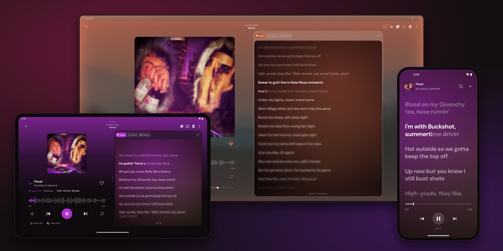

</div>

## What is Aurora?

Aurora is a music player and a Navidrome, Subsonic, Jellyfin and Plex client in one app. It also plays the music on your device and streams from YouTube Music, SoundCloud and Green Music App, and it can merge all of them into a single library where each song plays from the best copy you have.

Under the library sits a 64-bit audio engine with parametric EQ, a 16-stage effects rack, measured headphone corrections and bit-perfect output to USB DACs. You can ignore all of that and just press play, or tune every stage. No Aurora account, no ads and no tracking.

## Why people pick it

| Everyday listening | Audio you can tune |
| --- | --- |
| One library across your files, servers and streaming services | 64-bit DSP with graphic and parametric EQ |
| Lyrics that light up word by word, and can follow the singer's voice | A 16-stage rack: dynamics, convolution, crossfeed, reverb and more |
| AI DJ and AI playlists that run entirely on your device | 5,057 measured headphone and 1,083 speaker corrections |
| Downloads, offline mode, podcasts and internet radio | Bit-perfect USB DAC output up to 384 kHz, native DSD up to DSD1024 |
| Recaps, a listening heatmap and statistics that stay on your device | Exclusive output on Windows (WASAPI) and Linux (ALSA) |
| Tablet layouts, 4 interface styles and 17 languages | Signal Path shows exactly what happens to every sample |

## Screenshots

<table>
  <tr>
    <td align="center" width="25%">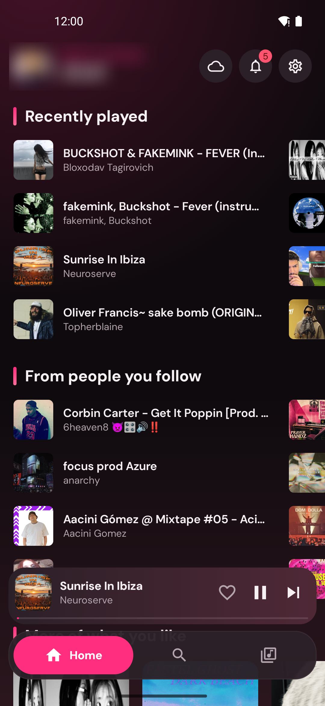<br><sub>Home</sub></td>
    <td align="center" width="25%">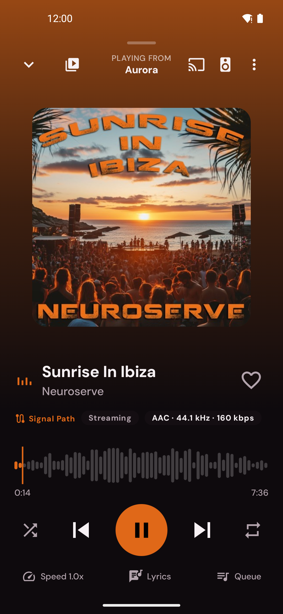<br><sub>Now Playing</sub></td>
    <td align="center" width="25%">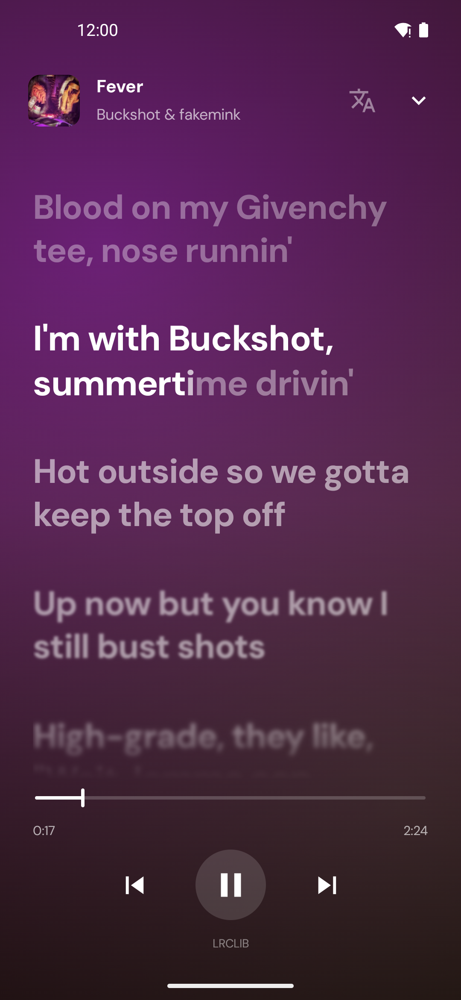<br><sub>Lyrics</sub></td>
    <td align="center" width="25%">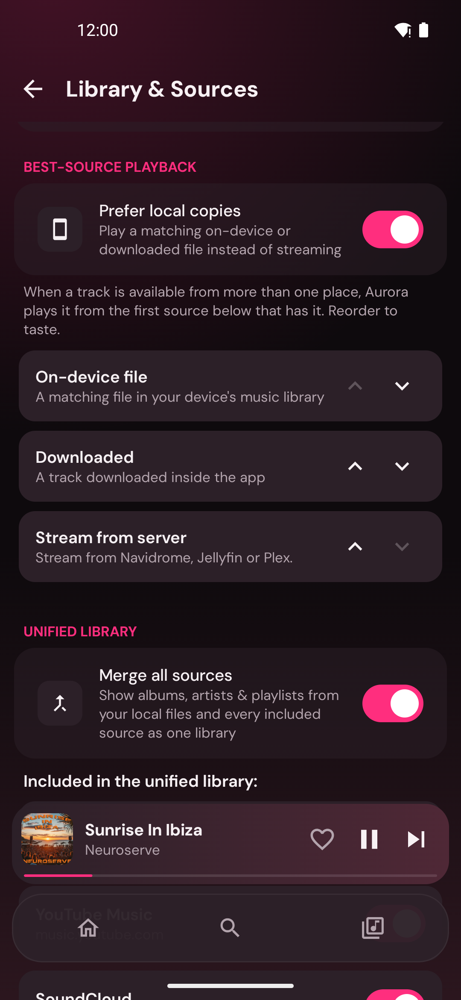<br><sub>Sources</sub></td>
  </tr>
  <tr>
    <td align="center">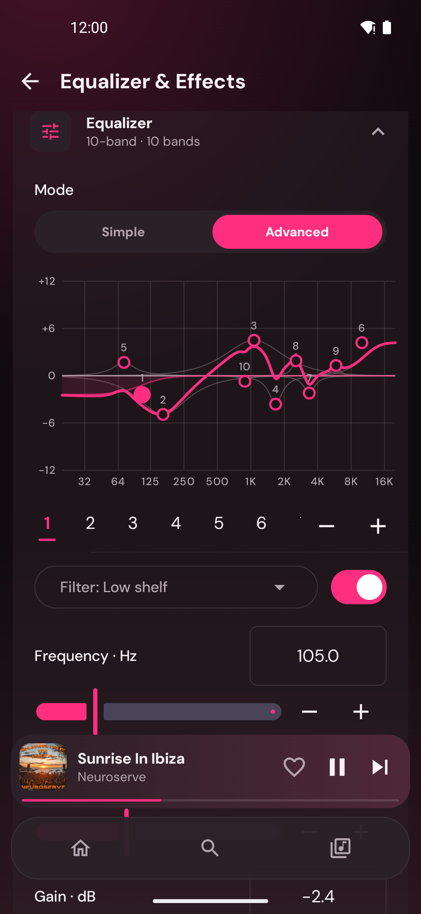<br><sub>Equalizer</sub></td>
    <td align="center">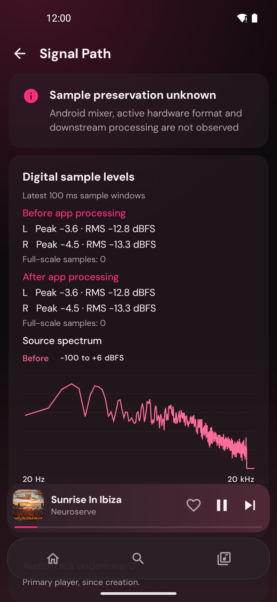<br><sub>Signal Path</sub></td>
    <td align="center">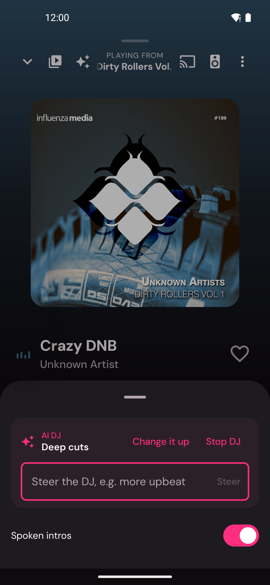<br><sub>AI DJ</sub></td>
    <td align="center">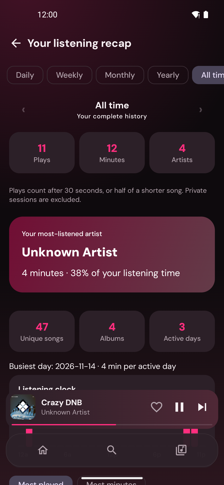<br><sub>Statistics</sub></td>
  </tr>
</table>

<table>
  <tr>
    <td align="center" width="50%">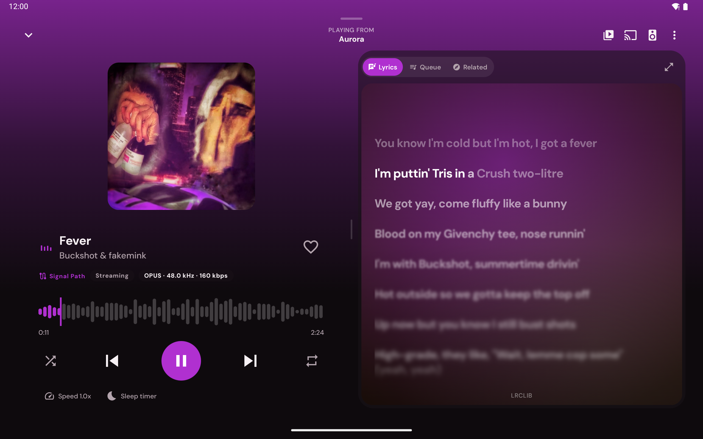<br><sub>Tablet</sub></td>
    <td align="center" width="50%">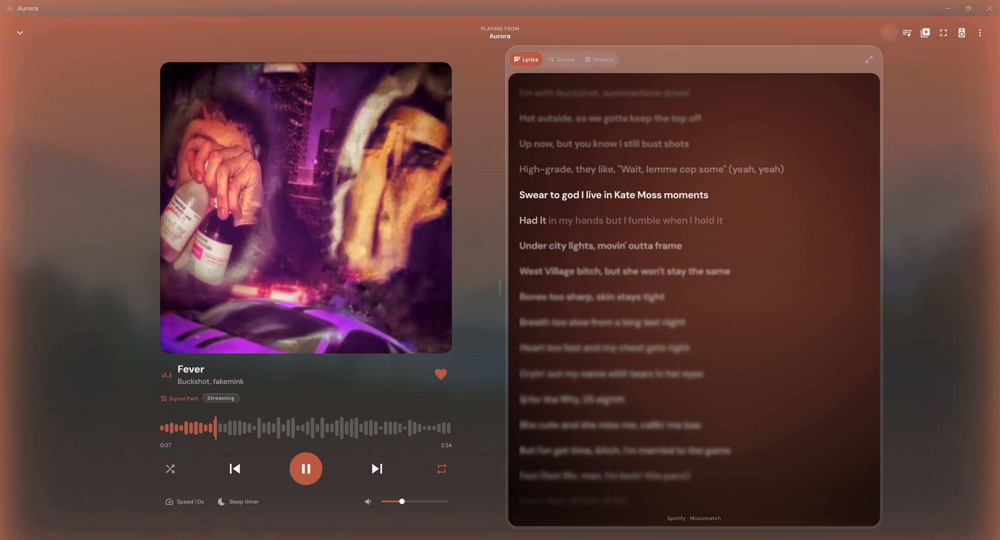<br><sub>Windows</sub></td>
  </tr>
</table>

<details>
<summary>Interface styles</summary>

<table>
  <tr>
    <td align="center" width="25%">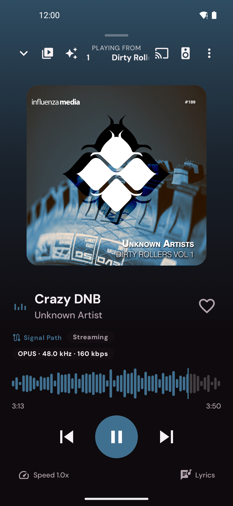<br><sub>Aurora</sub></td>
    <td align="center" width="25%">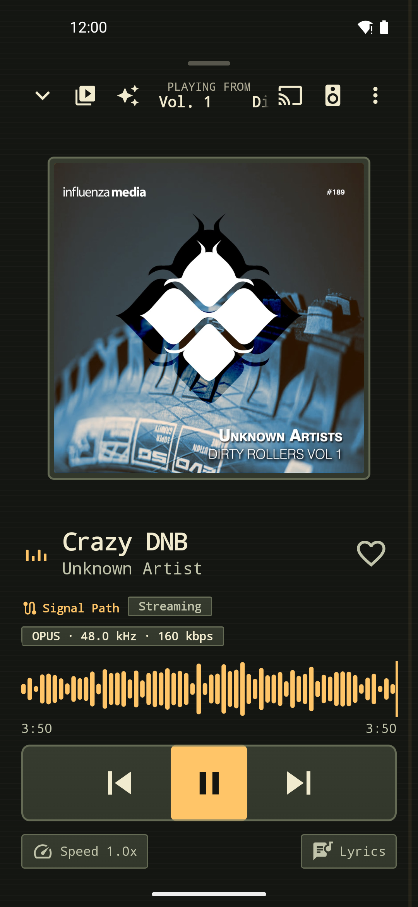<br><sub>Retro hi-fi</sub></td>
    <td align="center" width="25%">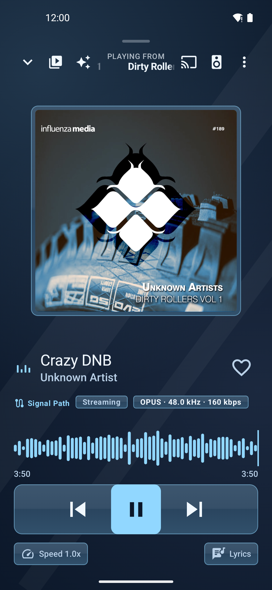<br><sub>Aero</sub></td>
    <td align="center" width="25%">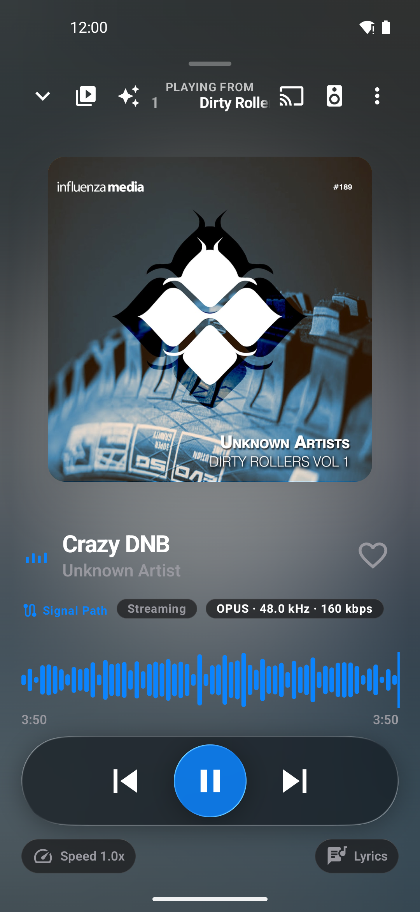<br><sub>Liquid Glass</sub></td>
  </tr>
</table>

</details>

## Download

| Platform | File | Needs |
| --- | --- | --- |
| Android phone or tablet | `Aurora-<version>.apk` | Android 8.0 or newer, 64-bit |
| Windows | `.exe` or `.msi` installer | Windows 10 or 11, x64. Java is included. |
| Linux (beta) | `.deb`, `.rpm` or AppImage, each in a zip | x86_64, glibc 2.35 or newer. Java is included. |
| macOS (experimental) | Build it yourself, see [mac/README.md](mac/README.md) | macOS 12 or newer, Apple silicon or Intel |

Get the files from the [latest release](https://github.com/nessli420/aurora/releases/latest). On Android, open the APK and allow installs from your browser if asked; Aurora updates itself from GitHub after that. The Windows installers aren't code-signed yet, so SmartScreen may ask you to confirm the first launch. There is no iOS version and no Google Play listing.

<details>
<summary>Installing on Linux</summary>

| Package | Install |
| --- | --- |
| Debian, Ubuntu and derivatives | `sudo apt install ./aurora_<version>_amd64.deb` |
| Fedora | `sudo dnf install ./aurora-<version>-1.x86_64.rpm` |
| openSUSE | `sudo zypper install ./aurora-<version>-1.x86_64.rpm` |
| Any distribution | `chmod +x Aurora-<version>-x86_64.AppImage`, then run it. If it won't start, install your distribution's FUSE package or add `--appimage-extract-and-run`. |

Media keys work through MPRIS. Server passwords go in your keyring (GNOME Keyring, KWallet or another Secret Service); without one, they last until Aurora closes. For exclusive output, pick the sound card itself under Output device, not the PipeWire or PulseAudio entry.

</details>

## Sources

| Source | What you need | Joins the merged library |
| --- | --- | --- |
| Music on this device | Nothing, just the files | Yes |
| Navidrome, Subsonic, OpenSubsonic | Server address, username and password | Yes |
| Jellyfin | Server address, username and password | Yes |
| Plex | Server address and an [X-Plex-Token](https://support.plex.tv/articles/204059436-finding-an-authentication-token-x-plex-token/) | Yes |
| YouTube Music | Nothing to browse and play; a Google account for likes and playlists | As its own view |
| SoundCloud | Nothing to browse and play; a SoundCloud account for likes, comments and playlists | As its own view |
| Green Music App | A free or paid account, signed in inside Aurora. No API key and no Premium. | As its own view |
| Extensions (Android) | A compatible extension app; read-only libraries | No |

Turn on **Merge all sources** in Settings, under Library & sources, to combine them. Duplicates fold into one song, and Aurora plays the best copy it can reach: a file on your device first, then a download, then a server stream. A streaming track you also own plays from your own copy. Likes, playlist edits and play history go back to the source each song came from. The [merge guide](https://auroraplayer.lol/features/#merge) on the website explains every step.

YouTube Music, SoundCloud and Green Music App are unofficial integrations. Their streams are lossy, and a change on their side can break them until Aurora catches up.

## Features

The full, searchable list is on [auroraplayer.lol/features](https://auroraplayer.lol/features/). The highlights:

**Library and playback.** Albums, artists, folders, playlists and smart playlists, with gapless playback, crossfade and an editable queue saved per account. Import playlists from other services or files, find duplicates, fix tags, and split single-file albums with `.cue` sheets. Podcasts and audiobooks resume where you left off.

**Lyrics.** Synced lyrics from your server, the file itself (embedded or `.lrc`) or LRCLIB, highlighted word by word. On Android, Follow vocals listens to the track and moves each word onto the singing, and lyrics can be translated on the device.

**AI that stays on your device.** AI DJ builds sets from your listening history and talks between them. Ask for music by voice or text, or describe a playlist and let Aurora build it from real tracks in your library. The language model, speech recognition and natural voice are optional downloads, and nothing leaves the device.

**Sound.** A 64-bit engine with up to 64 bands per equalizer stage and 256 across the rack. Fit corrections from AutoEQ, squig.link or your own REW measurements, run impulse responses, compare presets in a blind ABX test, and bind presets to a DAC or a pair of headphones. A global reverb includes a Concert mode that places you in a venue.

**Output.** Direct USB output on Android skips every effect and software volume on the way to your DAC, and the phone's volume buttons drive the DAC's own hardware volume. DSF and DFF files play as native DSD or DoP; the FiiO KA13 is tested up to DSD256. Desktop exclusive mode does the same through WASAPI and ALSA, and Chromecast, DLNA and Aurora Connect send music to other devices.

**Listening history.** Daily to all-time recaps, a 7 × 24 listening heatmap, badges and shareable recap images, all kept on the device. Scrobble to Last.fm or ListenBrainz and show what's playing on Discord if you want to.

**Make it yours.** Four interface styles (Aurora, Retro hi-fi, Aero and Liquid Glass), light, dark and black modes, accent colours or Material You, 31 visualizers, tablet layouts with side panels, and 17 languages including Arabic and Urdu.

A few things are Android only: Chromecast and DLNA, USB DAC output on the phone, Follow vocals, lyric translation, widgets, Music Haptics, Android Auto, alarms and extensions.

## FAQ

<details>
<summary>Is Aurora a Navidrome or Jellyfin client for Android?</summary>

Yes. It signs in to Navidrome and any Subsonic or OpenSubsonic server, Jellyfin and Plex, on Android, Windows and Linux. You can use one server, several, or merge them with the music on your device.
</details>

<details>
<summary>Does it support bit-perfect playback?</summary>

Yes, with a USB DAC on Android (Direct mode) and with exclusive output on Windows (WASAPI) and Linux (ALSA). Signal Path reports whether samples reached the output unchanged, and says so honestly when it can't verify it.
</details>

<details>
<summary>Do I need an account or an API key?</summary>

No Aurora account exists. Local files need nothing, servers use your own login, and YouTube Music and SoundCloud play without signing in at all. Last.fm, ListenBrainz and AcoustID are optional and use your own keys.
</details>

<details>
<summary>Does it work with Spotify?</summary>

Yes. Green Music App is Aurora's name for its Spotify source: sign in inside the app to browse your library, playlists and synced lyrics, with no API key or Premium. The audio plays from matching YouTube recordings or your own copies.
</details>

<details>
<summary>Is it free?</summary>

Yes. Aurora is open source under the Apache 2.0 license, with no ads, subscriptions or analytics.
</details>

<details>
<summary>Why isn't it on Google Play?</summary>

Releases are published on GitHub, and the Android app updates itself from there after you install it once.
</details>

## Build from source

<details>
<summary>Requirements and commands</summary>

You need JDK 21, Android SDK 35 (compileSdk 36), NDK 27.0.12077973 and CMake 3.22.1. Always build with the included Gradle wrapper.

```bash
git clone https://github.com/nessli420/aurora.git
cd aurora
./gradlew :app:assembleDebug        # Android APK in app/build/outputs/apk/debug/
./gradlew :desktop:run              # run the desktop app
./gradlew :desktop:packageDistributionForCurrentOS   # MSI and EXE on Windows
./gradlew :desktop:packageDeb :desktop:packageRpm :desktop:packageAppImage   # Linux
mac/build.sh run                    # macOS, see mac/README.md
```

Set `sdk.dir` in `local.properties` if Android Studio hasn't. On Windows, use `gradlew.bat`. The Windows desktop build also needs Visual Studio 2022 Build Tools with the C++ workload. Linux needs a vendor JDK such as Temurin, a C++ compiler, CMake and the ALSA headers.

Run the tests with `./gradlew :core:test :desktop:test :app:testDebugUnitTest`. Shared code lives in `core/`, the Android app in `app/`, the desktop app in `desktop/` and the native audio code in `native/`.

</details>

## Contributing

Bug reports, fixes, translations and ideas are all welcome. Read [CONTRIBUTING.md](CONTRIBUTING.md), open an [issue](https://github.com/nessli420/aurora/issues/new/choose), or talk to us on [Discord](https://discord.gg/zrxXejkywP). For audio problems, include your device, DAC and the Signal Path report.

## Credits and license

Aurora is licensed under [Apache 2.0](LICENSE). Third-party code and models keep their own licenses.

<details>
<summary>Third-party projects</summary>

- [decent-player](https://github.com/Ma145/decent-player) provides the USB audio libraries ([notices](decent/NOTICE.md)).
- [libFLAC](https://github.com/xiph/flac), [Chromaprint](https://github.com/acoustid/chromaprint) with KissFFT, [Jellyfin's FFmpeg decoder](https://github.com/jellyfin/jellyfin-androidx-media) and [JAudiotagger](https://github.com/Adonai/jaudiotagger) handle decoding, fingerprints and tags.
- DST decoding derives from Peter Ross's FFmpeg decoder through DSD-Nexus ([notice](app/src/main/cpp/dst/NOTICE.md)).
- [NewPipeExtractor](https://github.com/TeamNewPipe/NewPipeExtractor) resolves YouTube streams. [JSch](https://github.com/mwiede/jsch) provides SFTP in the USB libraries.
- [MusicBrainz](https://musicbrainz.org) and the [Cover Art Archive](https://coverartarchive.org) provide metadata and artwork.
- Vocal separation uses Ultimate Vocal Remover's model on ONNX Runtime ([attribution](docs/vocal-separation-attribution.md)).
- AI features run on [llama.cpp](https://github.com/ggml-org/llama.cpp) with the optional Qwen3.5 0.8B model, [whisper.cpp](https://github.com/ggml-org/whisper.cpp) with the optional Whisper base model, and the optional Supertonic 3 voice (OpenRAIL-M, use restrictions apply) on ONNX Runtime ([attribution](docs/ai-dj-attribution.md)).
- Liquid Glass uses Kyant's [backdrop and shapes libraries](https://github.com/Kyant0/AndroidLiquidGlass).
- Built with Jetpack Compose, Media3 and [Compose Multiplatform](https://github.com/JetBrains/compose-multiplatform); the desktop app decodes with [FFmpeg](https://ffmpeg.org) (LGPL) through [JavaCPP](https://github.com/bytedeco/javacpp-presets).

</details>

Aurora is an independent project and isn't affiliated with any of the services or device makers named here.
